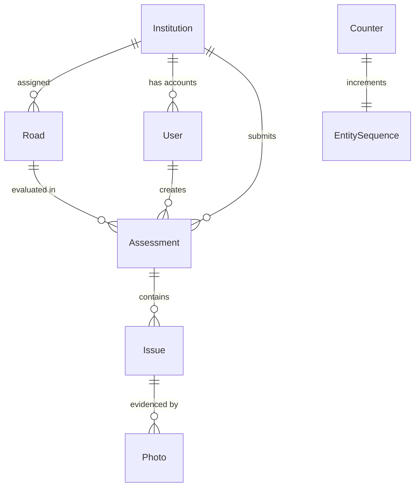

# Mission Clean Patiala — Engineering Charter & Agent Guidelines (AGENTS.md)

> **Document Version:** 3.0.0  
> **Target Audience:** Autonomous AI Coding Agents (Antigravity, Claude, Cursor, Copilot), Senior Architects, and Full-Stack Engineers.  
> **Status:** Active & Authoritative Single Source of Truth.  
> **Last Updated:** 2026-10-14  

---

## 1. Executive Summary & Domain Context

**Mission Clean Patiala (MCP)** is an institutional e-governance and environmental action platform initiated under the guidance of the **Punjab Pollution Control Board (PPCB)** and the **Municipal Corporation of Patiala (MC Patiala)**. 

### 1.1 Core Mission
The platform operationalizes community-driven urban accountability. Nominated educational institutions, colleges, schools, and public departments across Patiala are designated as custodians of specific road stretches. Field assessors from these institutions identify, photograph, geolocate, and document road infrastructure deficiencies, environmental hazards, and sanitation lapses.

These assessments are aggregated into a central Plan of Action (PoA) dashboard where PPCB officers and district authorities triage issues, assign them to responsible civic agencies (e.g., MC Patiala, PWD, Horticulture Department, Traffic Police), establish resolution deadlines, and track remediation through to closure.

### 1.2 User Roles & Operational Responsibilities
| Role | Identity Key | Primary Responsibilities |
|---|---|---|
| **Institution** | `role: "institution"` | Assesses assigned road stretches; drafts road reports; logs geo-tagged issues with evidence photos and recommendation documents; submits final assessments. |
| **PPCB Officer / Superadmin** | `role: "officer"`, `role: "superadmin"` | District-wide oversight; KPI analytics monitoring; categorizes issues into official PPCB action heads; assigns responsible agencies, priorities, target dates, and statuses; creates and manages institution credentials; exports compliance CSVs. |
| **Civic Department** *(Extensible)* | `role: "department"` | Action agency viewing assigned issues; updating operational ground progress and uploading post-remediation evidence photos. |

---

## 2. Technology Stack & Architectural Decision Records (ADR)

### 2.1 Technology Matrix
```
Frontend (Decoupled SPA / GitHub Pages)
├── HTML5 + Bootstrap 5.3.8 + Vanilla CSS Design Tokens (css/styles.css)
├── ES Modules (js/config.js, js/index.js, js/dashboard.js)
├── Chart.js 4.4.7 (Donut and Horizontal Bar Analytics)
└── Native Geolocation API & HTML5 <dialog> Modals

Backend API (Stateless REST / Render)
├── Node.js 20+ / 22 LTS (Strict ECMAScript Modules: "type": "module")
├── Express.js 5.1.0 (Latest Express 5 routing, middleware & error handling)
├── Helmet 8.1.0 (HTTP Security Headers)
├── CORS 2.8.5 (Dynamic regex validation for GitHub Pages & local origins)
├── JSON Web Tokens (jsonwebtoken 9.0.2) + bcryptjs 3.0.2 (Cost 12)
└── Multer 2.0.2 (In-memory multipart file handling)

Database & Storage Layer
├── MongoDB Atlas via Mongoose 8.15.0
├── Atomic Sequence Counters (Counter model for deterministic integer IDs)
├── Cloudinary v2 SDK (Persistent cloud storage with auto-compression)
└── Local Disk Fallback (/uploads/ directory with UUID file naming)
```

### 2.2 Architectural Decision Records (ADRs)

#### ADR 01: Evolution from LowDB to MongoDB Atlas with Numeric IDs
* **Context:** The prototype initially stored data in a local `data/db.json` file using LowDB. When deploying to cloud container platforms like Render, ephemeral filesystems wiped data on redeploys.
* **Decision:** Migrated to MongoDB Atlas with Mongoose.
* **Invariant:** To prevent breaking the frontend contracts (which rely on integer IDs like `#1`, `assessmentId: 5`), an atomic `Counter` collection was introduced using `findOneAndUpdate({ $inc: { seq: 1 } })`. All entities retain sequential numeric `id: Number` primary keys. **Do not replace integer IDs with raw Mongo ObjectIds in API responses.**

#### ADR 02: Dual Storage Engine (Cloudinary + Local Disk Fallback)
* **Context:** Local file storage fails on cloud server restarts, but development environments may run offline or without API keys.
* **Decision:** `src/storage.js` inspects `CLOUDINARY_*` environment variables. If present, files stream directly into Cloudinary with automated resizing (1600x1600 max, auto-format, auto-quality for images) and raw resource types for PDFs/Office docs. If absent, it gracefully falls back to storing in `./uploads/`.

#### ADR 03: Express 5 Routing & Wildcard Handling
* **Context:** Express 5 uses `path-to-regexp` v8, which disallows bare `*` wildcard routes (e.g. `app.options('*')` throws a syntax error).
* **Decision:** Preflight CORS is handled natively through `app.use(cors(corsOptions))`. Agents must not introduce bare `*` wildcard path strings in Express 5 route definitions.

---

## 3. Repository Directory Structure & Module Responsibilities

```
c:\Users\DELL\OneDrive\Desktop\Mission-Clean-Patiala (1)\Mission-Clean-Patiala\mission-clean-patiala\
├── .github/
│   └── workflows/
│       └── deploy.yml          # GitHub Actions workflow deploying frontend to GitHub Pages
├── css/
│   └── styles.css              # Custom CSS design system, CSS variables, glassmorphism, responsive grid
├── data/
│   └── db.json                 # Historical LowDB dataset (kept for reference and migrate.js)
├── images/
│   └── punjab-logo.png         # Punjab Government official emblem branding
├── js/
│   ├── config.js               # Frontend API base URL configuration (API_BASE)
│   ├── index.js                # Landing page login controller & role toggle
│   └── dashboard.js            # Unified dashboard controller (KPIs, Charts, Forms, Admin workbench)
├── scripts/
│   └── migrate.js              # One-time migration script (data/db.json -> MongoDB Atlas)
├── src/
│   ├── auth.js                 # JWT verification middleware & role-based access control (allow)
│   ├── db.js                   # Mongoose schemas, DB connection, counter generator & seed logic
│   ├── institutions-data.js    # Pre-seeded master registry of 26 institutions and road stretches
│   ├── issue-categories.js     # Taxonomy mapping: 8 Officer heads <-> 26 Institution issues
│   ├── routes.js               # Complete Express REST API router (Auth, Dashboard, Assessments, Admin)
│   └── storage.js              # Cloudinary cloud upload handler with local disk fallback
├── uploads/                    # Local storage directory for uploads (when Cloudinary not configured)
├── .env                        # Local environment variables (IGNORED in git)
├── .gitattributes              # Git line-ending normalizations
├── .gitignore                  # Git ignore rules for node_modules, .env, uploads, and caches
├── dashboard.html              # Main single-page application dashboard interface
├── index.html                  # Responsive split landing page with role-switched login
├── package.json                # Project dependencies, scripts, and ESM definition
├── package-lock.json           # Deterministic dependency tree lockfile
├── README.md                   # Human-facing quick-start readme
├── render.yaml                 # Render Infrastructure-as-Code blueprint for backend deployment
└── server.js                   # Application entry point, Express configuration, CORS, server bootstrap
```

---

## 4. Domain Model & Data Schemas

All models are defined in [src/db.js](file:///c:/Users/DELL/OneDrive/Desktop/Mission-Clean-Patiala%20%281%29/Mission-Clean-Patiala/mission-clean-patiala/src/db.js). Every schema disables Mongoose `versionKey` and transforms JSON output to suppress internal `_id`.



### 4.1 Schema Definitions

#### 1. Counter (`Counter`)
Used by `nextId(name)` to produce deterministic, collision-free auto-incrementing integers.
```javascript
{
  _id: String,     // Name of sequence: 'users' | 'institutions' | 'roads' | 'assessments' | 'issues' | 'photos'
  seq: Number      // Current highest sequence number
}
```

#### 2. User (`User`)
```javascript
{
  id:            { type: Number, unique: true },
  name:          String,
  email:         { type: String, lowercase: true },
  passwordHash:  String,
  role:          String,   // 'institution' | 'officer' | 'superadmin' | 'department'
  institutionId: Number    // Foreign key to Institution.id (null for officer/superadmin)
}
```

#### 3. Institution (`Institution`)
```javascript
{
  id:   { type: Number, unique: true },
  code: String,   // Short code, e.g. 'TIET', 'PMSHRI_MP'
  name: String    // Full formal name
}
```

#### 4. Road (`Road`)
```javascript
{
  id:            { type: Number, unique: true },
  institutionId: Number,   // Foreign key to Institution.id
  name:          String,   // Road name, e.g. 'Bhadson Road'
  stretch:       String,   // Road segment, e.g. 'Thapar Chowk to Tiwana Chowk'
  ward:          String    // Municipal ward identifier (optional)
}
```

#### 5. Assessment (`Assessment`)
```javascript
{
  id:            { type: Number, unique: true },
  institutionId: Number,   // Foreign key to Institution.id
  roadId:        Number,   // Foreign key to Road.id
  userId:        Number,   // Foreign key to User.id (Assessor who drafted report)
  assessorName:  String,   // Full name of assessor
  designation:   String,   // Assessor designation (e.g. 'Assistant Professor', 'Principal')
  contact:       String,   // Phone or contact details
  remarks:       String,   // General road assessment overview
  status:        String,   // 'Draft' | 'Submitted'
  createdAt:     String,   // ISO 8601 string
  updatedAt:     String,   // ISO 8601 string
  submittedAt:   String    // ISO 8601 string or null
}
```

#### 6. Issue (`Issue`)
```javascript
{
  id:                 { type: Number, unique: true },
  assessmentId:       Number,   // Foreign key to Assessment.id
  issueCode:          String,   // Formatted code: 'MCP-PAT-ROAD001-ISSUE-001'
  category:           String,   // High-level PPCB Officer category (8 categories)
  subcategory:        String,   // Specific issue selected by institution (26 issues)
  subcategoryDetails: String,   // Free-text details when subcategory is 'Other'
  legacyCategory:     String,   // Historical category tracking if re-categorized
  description:        String,   // Detailed field observations
  recommendation:     String,   // Assessor's proposed remediation (Mandatory)
  attachmentUrl:      String,   // Optional document URL (PDF/Word/Excel/Image)
  attachmentName:     String,   // Original file name of attachment
  attachmentPublicId: String,   // Cloudinary public ID for attachment
  latitude:           String,   // GPS Latitude (decimal degrees)
  longitude:          String,   // GPS Longitude (decimal degrees)
  accuracy:           String,   // Geolocation accuracy in meters (optional)
  priority:           String,   // 'High' | 'Medium' | 'Low'
  responsibleAgency:  String,   // e.g. 'MC Patiala', 'PWD', 'Horticulture', 'Traffic Police'
  status:             String,   // 'Reported' | 'Validated' | 'Returned' | 'Assigned for Action' | 'In Progress' | 'Completed' | 'Closed'
  targetDate:         String,   // Remediation deadline date string (YYYY-MM-DD)
  adminRemarks:       String,   // Administrative feedback and review notes
  createdAt:          String,   // ISO 8601 string
  updatedAt:          String    // ISO 8601 string
}
```

#### 7. Photo (`Photo`)
```javascript
{
  id:           { type: Number, unique: true },
  issueId:      Number,   // Foreign key to Issue.id
  path:         String,   // Absolute Cloudinary URL or local relative path '/uploads/...'
  publicId:     String,   // Cloudinary public ID (null for local storage)
  originalName: String,   // Original uploaded file name
  type:         String,   // 'Before' | 'After' | 'Evidence'
  uploadedAt:   String    // ISO 8601 string
}
```

---

## 5. Category Taxonomy & Normalization Engine

The category system bridge in [src/issue-categories.js](file:///c:/Users/DELL/OneDrive/Desktop/Mission-Clean-Patiala%20%281%29/Mission-Clean-Patiala/mission-clean-patiala/src/issue-categories.js) resolves institutional field observations to municipal governance heads:


### 5.1 Category Mapping Matrix
| PPCB Officer Head (8 Categories) | Mapped Institution Specific Issues (26 Subcategories) |
|---|---|
| **Plantation** | 1. Plantation<br>2. Tree guard requirement<br>3. Opportunity for beautification |
| **Pruning & Maintenance** | 4. Pruning<br>5. Horticulture waste |
| **Solid Waste Management** | 6. Waste accumulation<br>7. Construction & demolition waste<br>8. Open burning<br>9. Garbage Vulnerable Points on Road<br>10. Garbage Vulnerable Points at Vacant Plot |
| **Single-use plastic** | 11. Sale/purchase of single-use plastic |
| **Road Dust Mitigation** | 12. Patchwork<br>13. Pavement on road sides<br>14. Green landscaping on road sides<br>15. Pavement at divider<br>16. Green landscaping at divider |
| **Vehicular Emission Mitigation** | 17. Traffic congestion<br>18. Idling hotspot<br>19. Parking-related congestion<br>20. Encroachment affecting traffic flow |
| **Sensitisation / IEC** | 21. Awareness required for residents<br>22. Awareness required for RWA<br>23. Awareness required for shopkeepers/vendors<br>24. Awareness required for market associations<br>25. Awareness required for other commercial establishments |
| **Other Intervention** | 26. Other *(Requires mandatory `subcategoryDetails` explanation)* |

### 5.2 Normalization Rules
1. When an institution posts an issue, the backend checks `isValidIssue(selectedIssue)`.
2. `parentCat = categoryForIssue(selectedIssue)` computes the officer category.
3. In `GET /api/assessments` and `GET /api/admin/issues`, records pass through `normalizeIssueCategory(issue)` to guarantee consistent dual-level hierarchy even for legacy submissions.

---

## 6. Complete REST API Specifications

Base URL: `http://localhost:3000` (Local) / Configured Render URL (Production)  
Header Authentication: `Authorization: Bearer <jwt_token>`

### 6.1 Authentication & Master Data
| Method | Endpoint | Access | Request Body | Description |
|---|---|---|---|---|
| `POST` | `/api/auth/login` | Public | `{ email, password }` | Authenticates user; returns `{ token, user: { id, name, role, institution } }`. Token valid for 8 hours. |
| `GET` | `/api/master/categories` | Authenticated | *None* | Returns category taxonomy, officer heads, and ordered institution issues list. |
| `GET` | `/health` | Public | *None* | Health probe returning `{ status: "ok", database: "mongodb" }`. |

### 6.2 Institution Workflow
| Method | Endpoint | Access | Payload | Description |
|---|---|---|---|---|
| `GET` | `/api/institution/details` | `institution` | *None* | Returns `{ institutionName, assignedRoad, roadStretch }` for logged-in institution. |
| `GET` | `/api/assessments` | `institution`, `officer` | *None* | Lists assessments. Filtered by `institutionId` for institutions; all records for officers. Embeds road and issue details. |
| `POST` | `/api/assessments` | `institution` | `{ assessorName, designation, contact, remarks }` | Initializes a new road assessment in `Draft` status. |
| `POST` | `/api/assessments/:id/issues` | `institution` | `{ category, subcategoryDetails, description, recommendation, latitude, longitude, accuracy }` | Appends a geo-tagged issue to the draft assessment. Generates formatted `issueCode`. |
| `POST` | `/api/issues/:id/attachment` | `institution` | Multipart: `attachment` (Max 10MB) | Attaches PDF, Word, Excel, or image to the issue recommendation. |
| `POST` | `/api/issues/:id/photos` | All Roles | Multipart: `photo` (Max 8MB, Image only) | Uploads photo evidence linked to issue (`Before`, `After`, `Evidence`). |
| `PATCH` | `/api/assessments/:id/submit` | `institution` | *None* | Validates that assessment has $\ge 1$ issue; transitions status to `Submitted` with `submittedAt` timestamp. |

### 6.3 Officer & Administrative Operations
| Method | Endpoint | Access | Payload | Description |
|---|---|---|---|---|
| `GET` | `/api/dashboard` | Authenticated | *None* | KPI statistics: `{ assessments, issues, completed, pending }`. |
| `GET` | `/api/admin/issues` | `officer`, `superadmin`, `department` | *None* | Comprehensive triage list of all issues across all institutions, with linked road, institution, and photo details. |
| `PATCH` | `/api/admin/issues/:id` | `officer`, `superadmin`, `department` | `{ category, subcategory, subcategoryDetails, responsibleAgency, status, targetDate, adminRemarks }` | Updates issue categorization, agency assignment, workflow status, or target completion date. |
| `GET` | `/api/admin/institutions` | `officer`, `superadmin` | *None* | Lists all registered institutions, assigned stretches, and credential identifiers. |
| `POST` | `/api/admin/institutions` | `officer`, `superadmin` | `{ name, code, username, password, roadName, roadStretch }` | Registers a new institution, road assignment, and generates encrypted login credentials. |
| `POST` | `/api/admin/institutions/:id/reset-password` | `officer`, `superadmin` | `{ password }` | Resets the password for an institution user account. |
| `GET` | `/api/admin/export.csv` | `officer`, `superadmin` | *None* | Generates and streams standard CSV of all reported issues for reporting. |

---

## 7. Frontend Architecture & UI Engineering

The frontend is an intentionally lightweight, ultra-fast Vanilla ES Module application with zero bundling overhead, optimized for smooth execution on mobile and desktop devices.

### 7.1 Single-Page State & Tab Management
The application lifecycle in [js/dashboard.js](file:///c:/Users/DELL/OneDrive/Desktop/Mission-Clean-Patiala%20%281%29/Mission-Clean-Patiala/mission-clean-patiala/js/dashboard.js) is coordinated via `activateTab(tabId)`:
* `dashboardTab`: Executive metrics, KPI cards, and Chart.js analytics.
* `detailsTab` *(Institutions only)*: Institution metadata, assessment draft initiator, and issue logging forms.
* `assessmentsTab`: History table of drafted and submitted assessments.
* `officerView` *(Officers only)*: Interactive review and Plan of Action grid.
* `institutionsTab` *(Officers only)*: Administration console for adding institutions and resetting passwords.

### 7.2 Safe DOM Rendering & XSS Protection
To prevent Cross-Site Scripting (XSS), user-generated content must **never** be injected via unchecked template strings:
```javascript
// MANDATORY: Use escapeHtml for all dynamic strings rendered into innerHTML
function escapeHtml(value) {
  return String(value ?? '').replace(/[&<>"']/g, (character) => {
    const entities = { '&': '&amp;', '<': '&lt;', '>': '&gt;', '"': '&quot;', "'": '&#39;' };
    return entities[character];
  });
}
```

### 7.3 Chart.js Lifecycle Management
To avoid `Canvas is already in use. Chart with ID 'X' must be destroyed before the canvas can be reused` errors, chart instances are tracked in a `charts` registry and updated in-place via `upsertChart`:
```javascript
function upsertChart(key, config) {
  const existing = charts[key];
  if (existing) {
    existing.data.labels = config.data.labels;
    existing.data.datasets[0].data = config.data.datasets[0].data;
    existing.update();
    return;
  }
  charts[key] = new Chart(chartCanvases[key], config);
}
```

### 7.4 Form Flow & Resilience
1. **Two-Stage Assessment Creation**: Institutions must save the assessment draft header before the issue editor unblocks.
2. **Parallel Evidence Upload**: When adding an issue, the JSON issue record is created first. Photos and attachments are subsequently uploaded. If one upload fails, the UI aggregates and alerts upload errors without abandoning the created record.
3. **HTML5 `<dialog>` Modal**: Assessment submissions trigger `assessmentSuccessModal.showModal()`, resetting the form cleanly on dialog close.

---

## 8. Security, Authentication & Storage Engineering

### 8.1 JWT Authentication & Role Segregation
* Tokens are issued with an 8-hour lifetime signed by `process.env.JWT_SECRET`.
* Passwords are encrypted using `bcrypt.hash(password, 12)`.
* Role enforcement is applied at the routing layer via `allow(...roles)` middleware in [src/auth.js](file:///c:/Users/DELL/OneDrive/Desktop/Mission-Clean-Patiala%20%281%29/Mission-Clean-Patiala/mission-clean-patiala/src/auth.js).

### 8.2 CORS Configuration
The backend whitelist allows requests from any GitHub Pages deployment and local dev servers:
```javascript
const allowedOrigins = [
  /^https:\/\/[\w-]+\.github\.io$/, // GitHub Pages subdomains
  "http://localhost:3000",
  "http://127.0.0.1:3000",
  "http://localhost:5500",
  "http://127.0.0.1:5500",
];
```

### 8.3 Cloudinary Asset Pipeline
* **Images**: Uploaded to folder `mission-clean-patiala`, resized to a maximum bounding box of 1600x1600 px with `crop: 'limit'`, `quality: 'auto'`, and `fetch_format: 'auto'` to conserve bandwidth.
* **Documents**: Uploaded with `resource_type: 'raw'` and `filename_override`. Raw resource typing ensures PDFs, Word documents, and Excel spreadsheets remain downloadable without triggering Cloudinary's default image-delivery restrictions on free tier accounts.

---

## 9. Golden Rules for AI Agents & Engineers (Guardrails)

When modifying, extending, or refactoring the Mission Clean Patiala codebase, you **must adhere to these ten non-negotiable architectural invariants**:

1. **Preserve Numeric Sequence IDs:**  
   Do not switch primary keys from integers to Mongo ObjectIds in API responses. The frontend tables, URL routes, and export generators rely on integer IDs. Always use `await nextId('<entity_name>')`.

2. **Respect Express 5 Route Patterns:**  
   Never introduce bare wildcard routes like `app.options('*')` or `app.get('/*')`. Express 5 strict route parsing will crash the server on startup.

3. **Never Hardcode Secrets or Commit `.env`:**  
   Always consume secrets via `process.env`. If a new variable is added, document it in `render.yaml` and `.env.example`.

4. **Preserve Dual Storage Capability:**  
   Any changes to file storage must preserve the local fallback in `src/storage.js` so that developers can run and test offline without requiring Cloudinary credentials.

5. **Ensure Idempotent Data Seeding:**  
   The `seed()` function in `src/db.js` runs automatically on server start (`await seed()`). All upsert/create operations must be strictly idempotent (check `findOne` before inserting) to prevent duplicate records on restarts.

6. **Strict Separation of Data Access:**  
   `GET /api/assessments` must always scope queries for institution users (`{ institutionId: req.user.institutionId }`). Never expose records belonging to other institutions to an institutional account.

7. **Maintain Category Backward Compatibility:**  
   Any modification to categories must be reflected across both `src/issue-categories.js` and `dashboard.html` (`#category` `<select>` element) and must maintain `legacyIssueToCategory` support.

8. **Always Sanitize User-Rendered HTML:**  
   Any dynamic data rendered in `js/dashboard.js` or `js/index.js` must be wrapped in `escapeHtml()`.

9. **Keep Native Binaries Out of Dependencies:**  
   Do not introduce native C++ build dependencies (such as `sqlite3`, `better-sqlite3`, or `canvas`) to maintain effortless, instant deployment on Windows, macOS, Linux, and Render.

10. **Preserve Frontend Vanilla Architecture:**  
    Do not introduce bulky build steps (Webpack, Vite) unless explicitly directed by the project lead. The zero-build vanilla ES modules setup ensures immediate GitHub Pages compatibility.

---

## 10. Verification, Local Testing & Runbook

### 10.1 Local Environment Setup

1. **Verify Node.js Version:**
   ```bash
   node -v
   # Must be v20.x or v22.x LTS
   ```

2. **Configure Environment Variables (`.env`):**
   ```env
   PORT=3000
   JWT_SECRET=development-secret-change-me
   MONGODB_URI=mongodb+srv://<user>:<password>@cluster.mongodb.net/mission_clean_patiala
   CLOUDINARY_CLOUD_NAME=your_cloud_name
   CLOUDINARY_API_KEY=your_api_key
   CLOUDINARY_API_SECRET=your_api_secret
   ```

3. **Install Dependencies:**
   ```bash
   npm install
   ```

4. **Start Development Server:**
   ```bash
   npm run dev
   # Or npm start
   ```

5. **Verify Syntax Across the Codebase:**
   ```bash
   node --check server.js
   node --check src/db.js
   node --check src/routes.js
   node --check src/auth.js
   node --check src/storage.js
   node --check src/issue-categories.js
   node --check src/institutions-data.js
   ```

### 10.2 Default Demonstration Accounts
* **PPCB Officer (Administrative Review):**  
  Username: `officer@ppcb.gov.in`  
  Password: `Officer@123`

* **Institution (Thapar Institute - TIET):**  
  Username: `tiet@mcpatiala.in`  
  Password: `TIET@Patiala2026` *(or `Institution@123` legacy)*

* **Additional Institutions:**  
  All 26 pre-seeded institutions use standard accounts structured as:  
  Username: `<code-or-slug>@mcpatiala.in`  
  Default Password: `<CODE>@Patiala2026`

### 10.3 Troubleshooting Common Issues
* **CORS Error on API Call:**  
  Verify the frontend origin in `server.js` `allowedOrigins`. For custom local test servers (e.g. VS Code Live Server on port 5500), ensure `http://127.0.0.1:5500` is present.
* **MongoDB Connection Timeout:**  
  Verify your IP address is whitelisted in MongoDB Atlas Network Access (`0.0.0.0/0` for development).
* **Cloudinary Upload Returns 400/401:**  
  If Cloudinary credentials expire, remove or comment out `CLOUDINARY_CLOUD_NAME` in `.env`. The backend automatically reverts to saving uploads to the local `./uploads/` folder.
* **Chart Does Not Render:**  
  Confirm Chart.js CDN script (`https://cdn.jsdelivr.net/npm/chart.js@4.4.7/dist/chart.umd.min.js`) loaded successfully in network tab.

---

## 11. Strategic Roadmap & Extension Opportunities

Future development phases should focus on the following high-impact enhancements:
1. **Interactive GIS Map Tab:** Embed Leaflet.js or Mapbox GL JS with marker clustering displaying geo-tagged road issues across Patiala.
2. **Dedicated Civic Agency Logins:** Role-based access for MC Patiala, PWD, and Horticulture teams to update action status directly and upload "After" remediation photos.
3. **Automated WhatsApp/SMS Dispatch:** Webhook integration to notify ward officers when high-priority environmental hazards are reported.
4. **Offline PWA Support:** Add service worker caching and IndexedDB queueing to enable seamless offline assessments on rural or spotty connectivity stretches.
